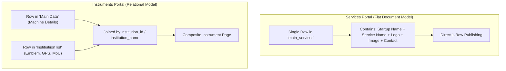
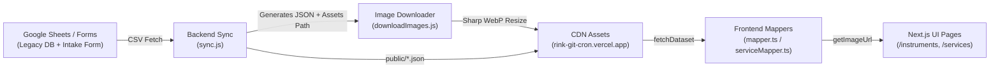

# RINK Data Entry, Maintenance & Proofreading Manual (SOP)
**Document Version:** 1.0 (Production)  
**Target Roles:** Non-Technical Data Entry Staff, Proofreaders, Content Auditors, and Operations Team  
**Scope:** RINK Instruments Portal & RINK Services Portal

---

## 1. Executive Overview & System Architecture

The RINK web portal dynamically synchronizes with master Google Spreadsheets via an automated background ingestion pipeline (`rink-git-cron`). 

To maintain clean data without technical failures, understand that the two portals use two distinct data models:



- **Services Portal (`main_services`):** **Self-Contained.** All startup and service data lives in a single row.
- **Instruments Portal (`Main Data` + `Instituitiion list`):** **Relational.** Machine specifications live in `Main Data`, but the institution's official logo, address, GPS coordinates, and MoU status live in `Instituitiion list`.

---

## 2. The 4 Golden Rules for Data Entry & Proofreaders

Before touching any spreadsheet, memorize these four mandatory rules:

> [!IMPORTANT]
> ### Rule 1: Google Drive Sharing Permission
> Any link pasted into an image or logo column **MUST** have its sharing settings set to:  
> **"Anyone with the link can view"**  
> *(If left as "Restricted", the automated pipeline cannot download the image, and the portal will fall back to vector illustrations.)*

> [!WARNING]
> ### Rule 2: Single Direct Files Only (No Folders, No PDFs)
> Image columns only accept direct image files (`.png`, `.jpg`, `.jpeg`, `.webp`).  
> **NEVER paste:**
> - Google Drive **folder links** (e.g. `drive.google.com/drive/folders/...`)
> - PDF brochures or specification documents
> - General website homepages (e.g. `https://mycompany.com`)

> [!TIP]
> ### Rule 3: Exact Startup & Institution Name Consistency
> The portal automatically groups services and instruments by name slug:
> - `"Acme Biotech Pvt Ltd"` and `"Acme Biotech"` will be treated as **two separate companies**!
> - Always use exact, standardized spelling across all rows.

> [!CAUTION]
> ### Rule 4: The Services "Approved" Gatekeeper
> In the Services sheet (`main_services`), column `approved` **MUST be set to `Yes`**.  
> If left blank, lowercase `yes`, or set to `No`, the automated pipeline skips the row entirely.

---

## 3. Services Portal Guide (`main_services` Tab)

### A. Column Mapping & Field Standards

| Column Header in Sheet | Internal Field | Required? | Accepted Values & Formatting Rules | Example |
|---|---|:---:|---|---|
| `approved` | `approved` | **YES** | Exactly `Yes` or `No`. Only `Yes` is published. | `Yes` |
| `startup_name` *(or col 3)* | `startupName` | **YES** | Clean, official registered startup name. Keep spelling identical across rows. | `BioQuatix Innovations` |
| `ksum_uid` | `ksumUid` | Optional | KSUM Unique ID assigned to the startup. | `KSUM-6782` |
| `service_name` *(or col 12)* | `serviceName` | **YES** | Name of the service offering. Capitalize words cleanly. | `High-Throughput Gene Sequencing` |
| `description` *(or col 13)* | `description` | **YES** | Clear paragraph explaining what the service provides, turnaround time, deliverables. | `Complete sample-to-report RNA extraction and sequencing...` |
| `category` *(or col 10)* | `category` | **YES** | High-level category (e.g. Testing, Prototyping, Synthesis, Analytics). | `Genomics & Biotechnology` |
| `sector` | `sector` | Optional | Industry vertical. Used for visual theme and fallback art. | `Healthcare / Life Sciences` |
| `upload_the_startup_logo_png_format` | `logo` | **Recommended** | Direct Google Drive or web link to square/transparent company logo. | `https://drive.google.com/file/d/1A2B.../view` |
| `image_link` *(or service_image)* | `thumbnail` | Optional | Direct link to photograph of the instrument or lab used for this service. | `https://drive.google.com/file/d/1C3D.../view` |
| `column_14` *(or equipment_used)* | `equipmentUsed` | Optional | Comma-separated list of machines used. | `Illumina NovaSeq 6000, PCR Thermocycler` |
| `column_15` *(or certifications)* | `certifications` | Optional | Accreditations or standards held. | `NABL Accredited, ISO 9001:2015` |
| `column_16` *(or infrastructure)* | `infrastructure` | Optional | Clean room rating, computing infrastructure, or facility type. | `Class 10,000 Clean Room` |
| `district` | `district` | **YES** | One of Kerala's 14 canonical districts. | `Ernakulam` |
| `address` | `address` | Optional | Physical office or lab address. | `Kinfra Hi-Tech Park, Kalamassery` |
| `enquiry_e_mail_address` | `email` | **YES** | Valid enquiry email address. | `contact@bioquatix.com` |
| `enquiry_phone_number` | `phone` | Optional | Phone number with country code. | `+91 9876543210` |
| `booking_link_or_official_website` | `bookingUrl` | Optional | Direct link to book or company website. | `https://bioquatix.com/booking` |

---

## 4. Instruments Portal Guide (`Main Data` & `Instituitiion list`)

### A. `Main Data` Tab (Equipment Specifications)

| Column Header in Sheet | Internal Field | Required? | Formatting Rules & Proofreader Checks | Example |
|---|---|:---:|---|---|
| `id` | `id` | **YES** | Unique alphanumeric identifier. Never leave blank. | `1042` or `CUSAT-018` |
| `instruments` | `instruments` | **YES** | Full official title of the instrument. | `Field Emission Scanning Electron Microscope` |
| `acronym` | `acronym` | **Recommended** | Short uppercase acronym. Avoid punctuation. | `FESEM` |
| `institution_name` | `institution_name` | **YES** | Exact name of the institution hosting the equipment. | `Cochin University of Science and Technology` |
| `institution_id` | `institution_id` | **YES** | Foreign key matching `Instituitiion list`. | `cusat` |
| `name_of_facility` | `name_of_facility` | Optional | Specific center or laboratory within the university. | `STIC (Sophisticated Test & Instrumentation Centre)` |
| `standardized_district` | `district` | **YES** | Canonical Kerala district name. | `Ernakulam` |
| `tag` | `tag` | **Recommended** | Comma-separated tags. Keep individual tags under 35 chars for chips. | `Electron Microscopy, Nanotechnology, Surface Analysis` |
| `image_link` | `image_link` | **Recommended** | Photo of the actual instrument in the lab (Drive public link). | `https://drive.google.com/file/d/1X9Y.../view` |
| `specifications` | `specifications` | Optional | Detailed technical parameters (voltage, resolution, detectors). | `Resolution: 0.8 nm at 15 kV; Magnification: 25x to 1,000,000x` |
| `website_booking_link` | `bookingUrl` | Optional | URL to institution's internal booking portal or form. | `https://stic.cusat.ac.in/booking` |
| `enquiry_mail` | `email` | Optional | Contact email for slot reservations. | `stic@cusat.ac.in` |
| `enquiry_contact_number` | `phone` | Optional | Contact number for the facility manager. | `0484 2577661` |

---

### B. `Instituitiion list` Tab (The Relational Master Record)

> [!IMPORTANT]
> If a data entry operator enters a brand-new university, college, or startup in `Main Data`, **they MUST also add a row to `Instituitiion list`**. If this step is missed, the equipment will display fallback monogram letters instead of the official logo, and will lack map directions.

| Column Header | Field | Importance | Purpose & Proofreader Rules | Example |
|---|---|:---:|---|---|
| `institution_id` | `institution_id` | **CRITICAL** | Unique lowercase slug. Must match `Main Data`. | `iit-palakkad` |
| `institution_name` | `name` | **CRITICAL** | Official registered university/institution title. | `Indian Institute of Technology Palakkad` |
| `slug` | `slug` | **CRITICAL** | URL slug. Lowercase with hyphens. | `indian-institute-of-technology-palakkad` |
| `logo_link` | `logo_link` | **HIGH** | Public Google Drive link to official high-res logo. | `https://drive.google.com/file/d/1L5M.../view` |
| `district` | `district` | **HIGH** | Canonical district. | `Palakkad` |
| `latitude` | `latitude` | **HIGH** | Decimal latitude for Google Maps directions. | `10.8240` |
| `longitude` | `longitude` | **HIGH** | Decimal longitude for Google Maps directions. | `76.7937` |
| `has_verified_mou` | `hasVerifiedMou` | Medium | Enter `TRUE` only if an official MoU is active with RINK. | `TRUE` |
| `website` | `website` | Medium | Institutional homepage URL. | `https://iitpkd.ac.in` |

---

## 5. Canonical District Reference (Kerala)

To prevent fragmented filters, always pick from these exact 14 spellings:

| Zone | Canonical District Names | Aliases to Avoid |
|---|---|---|
| **South Zone** | `Thiruvananthapuram`, `Kollam`, `Pathanamthitta` | *Avoid:* `Trivandrum`, `TVM`, `Quilon` |
| **Central Zone** | `Alappuzha`, `Kottayam`, `Idukki`, `Ernakulam`, `Thrissur` | *Avoid:* `Alleppey`, `Cochin`, `Kochi`, `Trichur` |
| **North-Central Zone** | `Palakkad`, `Malappuram` | *Avoid:* `Palghat` |
| **North Zone** | `Kozhikode`, `Wayanad`, `Kannur`, `Kasaragod` | *Avoid:* `Calicut`, `Cannanore`, `Kasargod` |

*(Note: The system contains automated normalization aliases, but using canonical spellings guarantees 100% consistency).*

---

## 6. Proofreader & Auditor Quick Checklist

Before marking a batch of rows as ready for automated sync, run this 60-second audit:

```
[ ] 1. GOOGLE DRIVE LINKS: Open each link in an Incognito / Private browser window.
       Did it load without asking you to log in? If it asks for login, it is RESTRICTED.
[ ] 2. APPROVAL STATUS: In 'main_services', is the 'approved' column set to 'Yes'?
[ ] 3. ACRONYMS: Are instrument acronyms capitalized without punctuation? (e.g. 'FTIR', not 'F.t.i.r.')?
[ ] 4. INSTITUTION MATCHING: Does every unique institution in 'Main Data' have an entry in 'Instituitiion list'?
[ ] 5. TAGS FORMAT: Are multiple tags separated by commas, with each tag under 35 characters?
[ ] 6. NO PLACEHOLDERS: Check that 'N/A', 'None', 'nil', or 'not specified' are left as blank cells.
```

---

## 7. How Data Reaches Production (The Cron Pipeline)

1. **Staff edits Google Sheets:** All changes are made directly in the Google Spreadsheets.
2. **Automated Sync (`rink-git-cron`):** Runs periodically, fetches updated rows, downloads newly added public images, optimizes them to WebP, and commits `instrument.json` and `services.json`.
3. **Frontend Rebuild (`rink-instruments`):** Next.js dynamically updates the live portal with fresh data, verified logos, and responsive image galleries.


---

### 8. How the System Currently Works (The 3-Layer Lifecycle)



1. **Ingestion & Tab Extension (`sync.js` in `rink-git-cron`):**
   - The engine reads [`config/sheets.yaml`](file:///c:/Users/1sree/Documents/rink-git-cron/config/sheets.yaml).
   - For any tab, it can combine a primary Google Sheet with secondary intake sheets using **`mergeSources`** (as is currently done for `instrument` by combining the master sheet with the live intake Google Form).
2. **Image Link Interception (`sync.js` lines 270–293):**
   - The engine checks each row's cells.
   - If `imageColumns` is **explicitly declared**, it only processes those columns.
   - If `imageColumns` is **omitted**, it uses a **fuzzy heuristic**: any column whose name contains `image`, `logo`, `photo`, `pic`, or `thumbnail` with a Google Drive URL or image extension is rewritten into `/assets/{sheet_name}/{id}_{column}.webp`.
3. **Asset Optimization & CDN Deployment (`downloadImages.js`):**
   - It iterates over every key starting with `original_` in the generated JSON.
   - It fetches the URL with `axios` and pipes it into `sharp` to produce 800px `.webp` files.
4. **Frontend Consumption (`rink-instruments`):**
   - The frontend fetches the compiled JSON endpoints from the CDN.
   - In `instrument`, [`mapper.ts`](file:///c:/Users/1sree/Documents/rink-instruments/src/domain/instrument/mapper.ts) calls `getImageUrl(instrument.image_link)` to prefix the CDN domain.
   - In `services`, [`serviceMapper.ts`](file:///c:/Users/1sree/Documents/rink-instruments/src/lib/serviceMapper.ts) now also calls `getImageUrl()`.

---